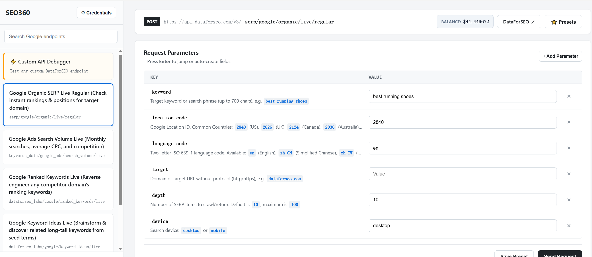
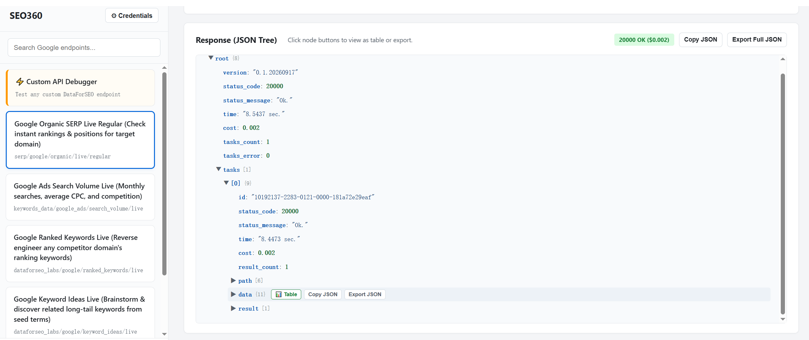

# SEO360: DataForSEO Free No-Code API Test Tool

A free, open-source [Chrome extension]([https://chromewebstore.google.com/detail/mpphhakiifalmlkphalklimjfkhkpbmp](https://chromewebstore.google.com/detail/seo360-dataforseo-free-no/mpphhakiifalmlkphalklimjfkhkpbmp)) to test DataForSEO endpoints with zero code. Inspect Google search rankings, search volumes, and custom API responses right in your browser.

---

## 🔒 Test Safely with Free $1 Credit

- **Zero Risk & Zero Cost**: Every new [DataForSEO account](https://seo360.pages.dev/dataforseo) comes with **$1 free testing credit**—you do not even need to enter a credit card to try it out.
- **Local Storage Only**: Your API credentials remain strictly in your browser. Requests go directly from your machine to official DataForSEO endpoints with no middleman servers.
- **Change Your Key Anytime**: Once you verify the data, you can immediately reset or revoke your API key inside the official DataForSEO dashboard. You are always in full control.

---

## Why Use It?

- **No Code Required**: Build API requests by selecting options instead of writing curl commands or Python scripts.
- **Pay Per Request**: Pay only wholesale provider rates (fractions of a cent per search) instead of expensive monthly SaaS subscriptions.
- **Direct & Private**: Your API keys stay in your browser. All requests go directly to DataForSEO with no middleman server.
- **Inspect & Export**: View responses in a clean JSON tree, preview nested data in tables, export raw query data, and save presets for team sharing.

---

## Preview

| Parameter Form (No Code) | Structured Output & JSON |
| :---: | :---: |
|  |  |

---

## Quick Setup

### 1. Install Extension
Add the extension to Chrome via the Web Store and pin it to your toolbar.

*(Or run from source: clone this repo, open `chrome://extensions/`, enable **Developer mode**, and click **Load unpacked**).*

### 2. Enter Credentials
Paste your DataForSEO Login and Password/Token into the extension credentials window.

### 3. Run Your Test
Select an endpoint (or enter a custom path), adjust your target keyword/country, and click **Send Request**.

---

## Presets & Team Collaboration

- **Save Presets**: Save custom query parameters with optional notes.
- **Import & Export**: Export your presets to share with colleagues or backup your workflows with zero duplicate entries.

---

## Feedback & Issues

Have an endpoint request or found a bug? Feel free to open a [GitHub Issue](https://github.com/aqrlouhanjoauhan/seo360/issues).

---

*Disclaimer: SEO360 is an independent open-source project and is not affiliated with, endorsed by, or sponsored by DataForSEO or Google LLC.*
