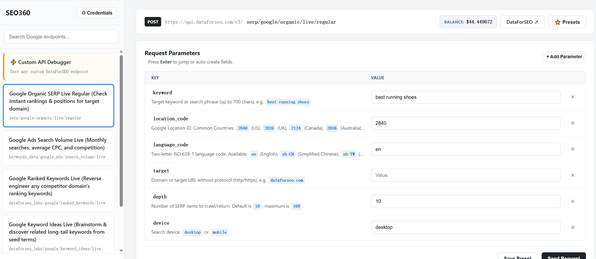
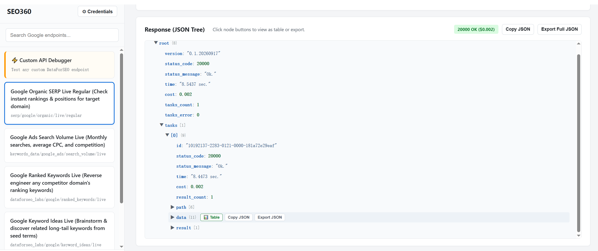

# SEO360: DataForSEO Free No-Code API Test Tool & MCP Server

A free, open-source toolkit for working with DataForSEO APIs with zero code—available as both a [Chrome extension](https://chromewebstore.google.com/detail/seo360-dataforseo-free-no/mpphhakiifalmlkphalklimjfkhkpbmp) for visual testing and a local **MCP Server** (`mcp/`) for controlled AI client workflows.

---

## Repository Structure

- [`index.html`](./index.html) — **Landing Page**: Official project homepage and overview.
- [`/chrome-extension`](./chrome-extension) — **SEO360 Chrome Extension**: Visual DataForSEO API debugging tool that lets you configure endpoints without code, inspect responses as a collapsible JSON tree or structured table view, generate code snippets, and save, import, or export reusable presets.
- [`/dataforseo`](./dataforseo) — **Endpoint & Schema Configurations**: Data-driven endpoint definitions and parameter configurations powering the Chrome extension.
- [`/mcp`](./mcp) — **SEO360 MCP Server** (`seo360-mcp`): Local Model Context Protocol server for AI clients (Claude Desktop, Cursor, Cherry Studio, Windsurf, Cline). Imports SEO360 preset packs to edit parameters and run DataForSEO requests with explicit confirmation and USD cost tracking. See [`mcp/README.md`](./mcp/README.md) for setup and full documentation.

---

## 🔒 Test Safely with Free $1 Credit

- **Zero Risk & Zero Cost**: Every new [DataForSEO account](https://try.dataforseo.com/seo360) comes with **$1 free testing credit**—you do not even need to enter a credit card to try it out.
- **Local Storage Only**: Your API credentials remain strictly in your browser. Requests go directly from your machine to official DataForSEO endpoints with no middleman servers.
- **Change Your Key Anytime**: Once you verify the data, you can immediately reset or revoke your API key inside the official DataForSEO dashboard. You are always in full control.

---

## Why Use It?

- **No Code Required**: Build API requests by selecting options instead of writing curl commands or Python scripts.
- **Pay Per Request**: Pay only wholesale provider rates (fractions of a cent per search) instead of expensive monthly SaaS subscriptions.
- **Direct & Private**: Your API keys stay in your browser. All requests go directly to DataForSEO with no middleman server.
- **Inspect & Export**: View responses in a collapsible JSON tree, preview nested data in tables, export raw query data, and save, import, or export presets for team sharing.

---

## Preview

| Parameter Form (No Code) | Structured Output & JSON |
| :---: | :---: |
|  |  |

---

## Quick Setup

### 1. Install Extension
Install SEO360 from the [Chrome Web Store](https://chromewebstore.google.com/detail/seo360-dataforseo-free-no/mpphhakiifalmlkphalklimjfkhkpbmp) and pin it to your toolbar.

### 2. Enter Credentials
Paste your DataForSEO Login and Password/Token into the extension credentials window.

### 3. Run Your Test
Select an endpoint (or enter a custom path), adjust your target keyword/country, and click **Send Request**.

---

## Presets & Team Collaboration

- **Save Presets**: Save custom query parameters with optional notes.
- **Import & Export**: Export your presets to share with colleagues, backup your workflows, or load into [`seo360-mcp`](./mcp).

---

## Feedback & Issues

Have an endpoint request or found a bug? Feel free to open a [GitHub Issue](https://github.com/aqrlouhanjoauhan/seo360/issues).

---

*Disclaimer: SEO360 is an independent open-source project and is not affiliated with, endorsed by, or sponsored by DataForSEO or Google LLC.*